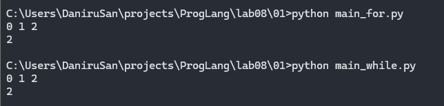
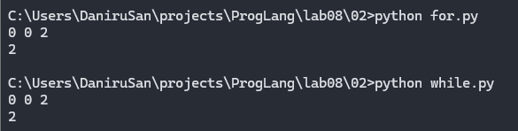
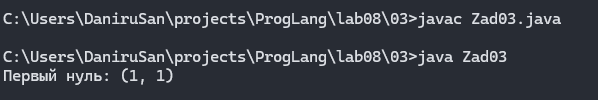
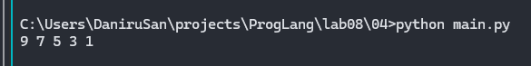
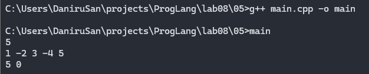
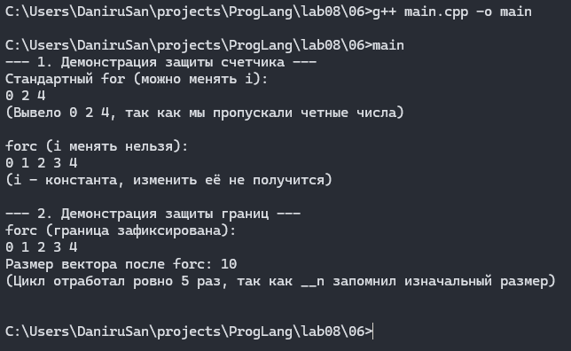
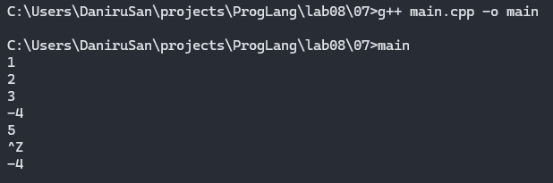
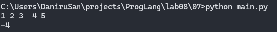
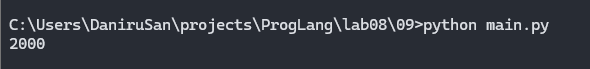
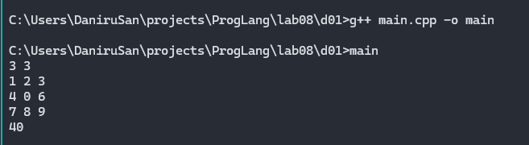

# Языки программирования
## Лабораторная работа 8

### Задание 1 **(2)**
*Рассмотрим программу на языке* **Python**.
```
x = [int(t) for t in input().split()]
for i in range(len(x)):
   if x[i] < i or x[i] > 2*i:
      break
print(i)
```
*Перепишите эту программу так, чтобы в ней использовался цикл* **while**, *в ней не использовалась
инструкция* **break**, *а используемый алгоритм не изменился. Полученная программа должна иметь следующий 
вид.*
```
x = [int(t) for t in input().split()]
i = 0
while ...:
   i += 1
print(i)
```
*Допишите правильное логическое выражение вместо многоточия. Выражение не должно содержать оператор* **not**.

Я написал `i < len(x)-1 and (x[i] >= i and x[i] <= 2*i`.\
Первая часть, до скобок, нужна, чтобы цикл не выходил за границы массива и выдавал верные значения.\
То что в скобках это логическая противоположность условию для `break` из цикла `for`.



### Задание 2 **(2)**
*Рассмотрим программу на языке* **Python**.
```
x = [int(t) for t in input().split()]
for i in range(len(x)):
   if i <= x[i] < 2*i or 3*i <= x[i] < 4*i:
      break
print(i)
```
*Перепишите эту программу так, чтобы в ней использовался цикл* **while**, *в ней не использовалась
инструкция* **break**, *а используемый алгоритм не изменился. Полученная программа должна иметь следующий 
вид.*
```
x = [int(t) for t in input().split()]
i = 0
while ...:
   i += 1
print(i)
```
*Допишите правильное логическое выражение вместо многоточия. Выражение не должно содержать оператор* **not**.

Я написал `i < len(x)-1 and (x[i] < i or x[i] >= 2*i) and (x[i] < 3*i or x[i] >= 4*i`.\
Первая часть, до скобок, нужна, чтобы цикл не выходил за границы массива и выдавал верные значения.\
То что в скобках это логическая противоположность условию для `break` из цикла `for`.



### Задание 3 **(2)**

*Напишите пример программы на* **Java** *с двумя вложенными циклами и инструкцией* **break** *для выхода
из двух вложенных циклов. В качестве такой программы можно взять поиск первого нуля в двумерном массиве.*

Я написал такую программу используя один `break` с помощью того, что в Java можно писать имя для циклов.
Я использовал это, чтобы завершить внешний цикл, как только программа находит нуль.

Вот какие данные я использовал:
```
{1, 2, 3}
{4, 0, 6}
{7, 8, 9}
```



### Задание 4 **(2)**

*Рассмотрим программу на языке* **Python**.
```
a = list(range(10))
b = [a.pop() - x for x in a]
print(*b)
```
*Объясните, почему список* **b** *получился именно таким.*

Цикл получился таким потому что список `a` изменяется прямо во время итерации. `a.pop()` удаляет последний элемент, а `x` берется по индексу с начала списка. То есть мы складываем первый элемент с последним, второй с предпоследним и так далее. Но так как длина списка уменьшается с каждым шагом, а индекс итерации растет, они встречаются ровно на середине.



### Задание 5 **(2)**

*Напишите программу на С++, которая прочитает натуральное число* **n**, *создаст вектор
из* **n** *элементов, прочитает значения элементов, добавит последний элемент вектора к каждому элементу 
(в том числе и к последнему), найдет и выведет количество положительных и отрицательных элементов вектора
после изменения. Из циклов в программе можно использовать только циклы по коллекции.*



### Задание 6 **(3)**

*Представим, что в некотором будущем стандарте* **С++** *появится конструкция*
```
forc(i, from, to)
```
*которая будет раскрываться в следующий код.*
```
{
   int __i = from, __n=to;
   for(const int &i= __i; i < __n; __i++) {
      ...
   }
}
```
*Чем эта конструкция отличается от стандартного цикла* **for**? *Укажите два основных различия.
Напишите программы для демонстрации этих различий.*

*Написанные программы сохраните в папку с номером задания.*

Фигурные скобки нужны для создания своей области видимости переменных.
Переменные с __ это скрытые переменные, которые программист не увидит.

Главная задача этой новой функции - защита от изменения границ цикла.
Благодарая тому, что i это константа, а __n это невидемая переменная, программист не может поменять границы цикла
что делает эту функцию истинной реализацией цикла со счётчиком.

Вот пример, что даст такая новая функция.\
 

### Задание 7 **(2)**

*Напишите программу на языке* **Python** *для проверки того, что все числа во введенной 
последовательности неотрицательные. Если в цикле будет найдено отрицательное число, цикл должен
прерваться и вывести найденное число. Если отрицательных чисел нет, то вывести некоторое сообщение об этом.*

*Программа должна использовать конструкцию* **for break else**.

*Запишите аналогичную программу на С++. Какие изменения в алгоритме решения в ней появились?. Почему?*

*Написанные программы сохраните в папку с номером задания.*

Изменения в алгоритме: в C++ нет конструкции `for...else`, поэтому пришлось добавить логическую переменную `found`. Она нужна, чтобы после цикла понять, был ли выполнен `break`, или цикл дошел до конца.

Вывод на C++:\


Вывод на Python:\


### Задание 8 **(2)**

*Рассмотрим следующую программу.* 
```
if x>=5 and y>=-5:
   print(0):
elif x<0 or y<0:
   print(1):
else:
   print(2):
```
*Опишите множества значений при которых программа выводит 0, 1 и 2. Например,*

A={ (x,y)| x ∈ [5;∞), y ∈ [-5;∞)}

Если `x>=5 and y>=-5`, выводится 0.\
Иначе, если `x<0 or y<0`, выводится 1.\
Иначе выводится 2.

Множества значений:\
B = { (x,y) | x < 0 } ∪ { (x,y) | y < -5 } ∪ { (x,y) | 0 ≤ x < 5, -5 ≤ y < 0 }\

C = { (x,y) | 0 ≤ x < 5, y ≥ 0 }

###  Задание 9 **(3)**
*Напишите программу на языке Python для решения следующей задачи.*

*Задана пронумерованная последовательность логических значений* **t(0),t(1),..,t(n)**, **t(i) ∈ {False,True}**

*Последовательность обладает следующим свойством: существует некоторое число k такое, что 
все значения* **t(0),t(1),...,t(k-1)** *равны* **False**, *а все значения* **t(k), ... , t(n)** *равны* **True**,
*то есть слева от* **k** *находятся значения* **False**, *а справа* - **True**. *Последовательность задается
функцией* **t(i)**, *которая возвращает логическое значение. Например, для тестирования эту функцию можно
задать следующим образом.*
```
def t(i):
   return i>=1000
```

*Требуется написать программу, которая найдет число* **k**. *Программа должна реализовывать алгоритм 
бинарного поиска. Диапазон поиска задается переменными* **left** и **right**. *На каждом шаге вычисляется
центр диапазона, значение в нем проверяется, после чего диапазон сокращается в два раза.*

*Алгоритм должен быть записан через цикл* **while** *и реализовывать инвариант цикла*

t(left)=False ∧ t(right)=True

```
left = -1
right = 10**18
while ...:
   mid = ...
   if t(mid):
      ...
   else:
      ...
print(...)
```

**Инвариант цикла**: `t(left) == False` и `t(right) == True`.\
**Почему он выполняется**\
До цикла мы задаем `left = -1` (заведомо ложь) и `right = 10**18` (заведомо истина).
Внутри цикла мы берем `mid`. Если `t(mid)` истина, значит `k` находится слева от `mid` или равен ему, поэтому мы сдвигаем правую границу (`right = mid`). Инвариант сохраняется, так как новое `right` истинно.
Если `t(mid)` ложь, значит `k` строго справа, сдвигаем левую границу (`left = mid`). Новое `left` ложно, инвариант снова сохранен.
Цикл заканчивается, когда `right - left == 1`. По инварианту `left` ложно, а `right` истинно. Так как между ними нет других чисел, `right` — это и есть первое истинное значение (искомое `k`).


## Дополнительные задания

### Задание 1 **(5)**

*Напишите программу на языке С++, которая будет находить сумму элементов в матрице и использовать для суммирования только один цикл* **for**. *(То есть вложенные циклы использовать нельзя).*
Этот цикл позволяет обойти двумерную матрицу `a` (размером `n` строк на `m` столбцов) так, как если бы она была вытянута в одну длинную строку (одномерный массив).

**Как работает переменная `idx`**\
Переменная `idx` пробегает значения от `0` до `n * m - 1`. Это общее количество элементов в матрице.  Например, если матрица `3` на `4` (3 строки, 4 столбца), то `n * m = 12`. Цикл `idx` пробежит значения: `0, 1, 2, ..., 11`.

**Как получить номер строки**\
`idx / m` Здесь используется **целочисленное деление**. Так как в каждой строке ровно `m` элементов, то: * Пока `idx` меньше `m` (от 0 до 3 при `m=4`), `idx / m` дает `0` (нулевая строка). * Когда `idx` достигает `m` и идет дальше (от 4 до 7), `idx / m` дает `1` (первая строка). * И так далее. То есть `idx / m` вычисляет, в какой **строке** находится текущий элемент.

**Как получить номер столбца**\
`idx % m` Здесь используется **остаток от деления**. Остаток от деления на `m` циклически пробегает значения от `0` до `m - 1`: * `0 % 4 = 0` * `1 % 4 = 1` * `2 % 4 = 2` * `3 % 4 = 3` * `4 % 4 = 0` (снова началась новая строка) То есть `idx % m` вычисляет, в каком **столбце** находится текущий элемент.


