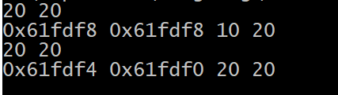
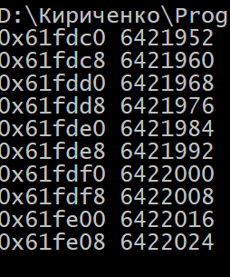
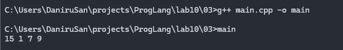
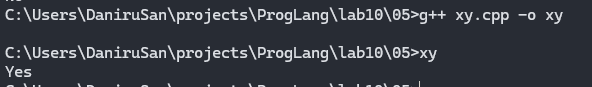
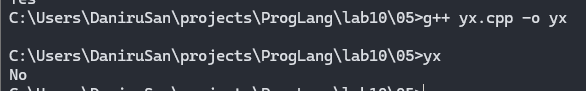
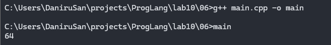
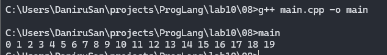
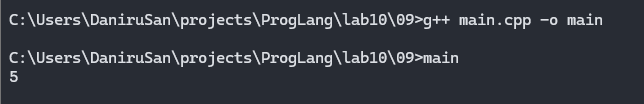
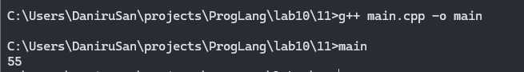

# Языки программирования
## Лабораторная работа 10

### Задание 1 **(2)**

*Рассмотрите следующие фрагменты программ. Запишите, что означают символы* **&** и  * *в каждом случае применения.*
```
int a = 10, b = 20;
int *p = &a , *q = &b;
p = q;
std::cout << *p <<' '<< *q << std::endl;
```
```
int a = 10, b = 20;
int *p = &a , *q = &b;
*p = *q;
std::cout << *p <<' '<< *q << std::endl;
```
*Чем различаются присваивания в третьей строке? Что можно вывести,
чтобы показать различия?*

*Примеры программ сохраните в папке с номером задания. Скриншоты работы прикрепите к отчету.*

**Ответ:**

В первой программе `*` при объявлении `int *p` — объявление указателя, а `&a` — взятие адреса переменной `a`. В строке `p = q;` копируется сам указатель (адрес), поэтому `p` начинает указывать на `b`. При выводе `*p` и `*q` — это разыменование, оба указателя смотрят на `b`, поэтому выводится `20 20`.

Во второй программе `*p = *q;` — разыменование с обеих сторон: по адресу `p` (то есть в `a`) записывается значение по адресу `q` (из `b`). Указатели при этом не меняются. Поэтому `a` становится равно `20`, а `p` по-прежнему указывает на `a`, `q` — на `b`.

Чтобы показать различие, можно вывести сами адреса `p` и `q`, а также значения `a` и `b`: в первом случае адреса `p` и `q` совпадают, а `a` и `b` не меняются; во втором — адреса разные, но `a` стало равно `b`.

Программы: [01/a.cpp](01/a.cpp) и [01/b.cpp](01/b.cpp).



### Задание 2 **(1)**

*Рассмотрим следующую программу.* 
```
double x[10];
for (int i = 0; i <10; i++)
    std::cout << &x[i] << std::endl;
```
*Что она выводит? Измените
вывод так, чтобы адреса выводились в десятичной системе счисления.
Объясните почему числа составляют арифметическую прогрессию с
определенным шагом.*

*Записанную программу сохраните в папке с номером задания.*
*Скриншоты работы прикрепите к отчету.*

**Ответ:**

Программа выводит адреса элементов массива в шестнадцатеричном виде. Чтобы выводить их в десятичной системе счисления, достаточно привести адрес к целому числу: `reinterpret_cast<size_t>(&x[i])`.

Адреса образуют арифметическую прогрессию, потому что элементы массива расположены в памяти подряд, а шаг прогрессии равен размеру одного элемента — `sizeof(double)` = 8 байт.

Программа: [02/main.cpp](02/main.cpp).



### Задание 3 **(2)**

*Токен* **«*»** *в языке C++ может использоваться в трех различных
случаях. Аналогично токен* **«&»** *также может использоваться в трех
случаях. Приведите пример одной программы в которой они были бы
использованы во всех случаях.*

*Записанную программу сохраните в папке с номером задания.*



**Токен `*` используется в**
* Умножение
* Объявление указателя
* Разыменование

**Токен `&` используется в**
* Побитовое И
* Взятие адреса
* Объявление ссылки

### Задание 4 **(2)**

*Выпишите значения всех переменных, в том числе указателей,
после выполнения каждой инструкции программы. Объясните, что
происходит в результате выполнения каждой инструкции.*
```
unsigned a = 8, b = 3 ,c = 17;
unsigned *p = &a;
unsigned *q = &b;
*p += *q + c;
c = *q;
p = &c;
c += a;
*p += 10;
*q = *p;
q = p ;
*q += 10;
```

**Ответ:**

| Инструкция | a | b | c | p | q |
|---|---|---|---|---|---|
| `unsigned a = 8, b = 3, c = 17;` | 8 | 3 | 17 | — | — |
| `unsigned *p = &a;` | 8 | 3 | 17 | &a | — |
| `unsigned *q = &b;` | 8 | 3 | 17 | &a | &b |
| `*p += *q + c;` | 28 | 3 | 17 | &a | &b |
| `c = *q;` | 28 | 3 | 3 | &a | &b |
| `p = &c;` | 28 | 3 | 3 | &c | &b |
| `c += a;` | 28 | 3 | 31 | &c | &b |
| `*p += 10;` | 28 | 3 | 41 | &c | &b |
| `*q = *p;` | 28 | 41 | 41 | &c | &b |
| `q = p;` | 28 | 41 | 41 | &c | &c |
| `*q += 10;` | 28 | 41 | 51 | &c | &c |

Объяснение:
- `*p += *q + c;` — к значению `a` прибавляется значение `b` и `c`: 8 + 3 + 17 = 28.
- `c = *q;` — в `c` копируется значение `b`.
- `p = &c;` — `p` теперь указывает на `c`.
- `c += a;` — к `c` прибавляется `a`.
- `*p += 10;` — увеличивается значение по адресу `p`, то есть `c`.
- `*q = *p;` — значение `c` записывается в `b`.
- `q = p;` — `q` начинает указывать туда же, куда `p` (на `c`).
- `*q += 10;` — снова увеличивается `c`.

### Задание 5 **(1)**

*Что сравнивается в приведенной ниже программе? Как можно
изменить первую строчку программы, чтобы результат тоже
изменился?*
```
int x = 1, y = 2;
int *p = &y, *q = &x;
if (p < q)
    std::cout << "Yes";
else
    std::cout << "No";
```

Программа сравнивает указатели, их номер, который сравнивается в `if`, зависит от порядка создания переменной, на которую указатель указывает.
То есть, в зависимости от того, какая переменная будет объявлена первой, будет разный вывод, не смотря на то какие данные хранятся в переменных.

Вывод при создании сперва `x`, а затем `y`\


Вывод при создании сперва `y`, а затем `x`\


### Задание 6 **(2)**

*Объясните работу следующей программы. Как изменится
результат, если тип* **double** *изменить на некоторый другой, например*
**int** *или* **char**?
```
double x = 0;
double *d = &x;
std::cout << reinterpret_cast<size_t>(d + 4) - reinterpret_cast<size_t>(d - 4) << std::endl;
```

**Ответ:**

`d` — указатель на `double`, `d + 4` и `d - 4` — адреса элементов, сдвинутых на 4 вправо и влево. `reinterpret_cast<size_t>` переводит адрес в целое число, поэтому разность равна расстоянию в байтах. Между `d - 4` и `d + 4` находится 8 элементов по `sizeof(double)` = 8 байт, то есть 8 * 8 = 64.

Если заменить `double` на `int`, результат будет 8 * 4 = 32, а на `char` — 8 * 1 = 8, потому что меняется размер элемента.



### Задание 7 **(2)**

*Объясните работу следующей программы. Как изменится
результат, если тип* **double** *изменить на некоторый другой, например*
**int** *или* **char**?
```
std::cout << reinterpret_cast <double*>(3000) - reinterpret_cast <double*>(2000) << std::endl;
```

**Ответ:**

`reinterpret_cast<double*>(3000)` и `reinterpret_cast<double*>(2000)` — это указатели с адресами 3000 и 2000. При вычитании указателей результат делится на размер элемента, поэтому получаем (3000 - 2000) / sizeof(double) = 1000 / 8 = 125.

Для `int` результат был бы 1000 / 4 = 250, для `char` — 1000 / 1 = 1000. Формально вычитание указателей на разные объекты — неопределённое поведение, но на практике результат считается как разность адресов, делённая на размер типа.

### Задание 8 **(2)**

*Что надо дописать в записанной ниже программе вместо многоточий, чтобы
она выводила все числа из массива* **a**? *Почему?*
```
int a[20];
for ( int i = 0; i < 20; i++)
    a[i] = i;
int *b=a + 8;
for (int i =...; i <...; i++)
    std::cout << b[i] <<' ';
```

**Ответ:**

Нужно написать `for (int i = -8; i < 12; i++)`, потому что `b` указывает на `a[8]`. Чтобы вывести элементы начиная с `a[0]`, нужен отрицательный индекс `-8`, а чтобы дойти до последнего `a[19]` — индекс `11`, поэтому условие `i < 12`. В итоге выводятся все 20 чисел от 0 до 19.




### Задание 9 **(2)**

*Что выводит следующая программа? Изменится ли результат если
изменить тип элементов массива?*

```
int a[10];
std::cout << &a[8] - &a[3] << std::endl;
```

Нет, не поменяется, так как меняется размер элементов массива, а разница между ними остаётся одинаковой.



### Задание 10 **(1)**

*Есть ли разница между инициализацией* **p** и **q** *в следующей программе? Обоснуйте ответ.*
```
int x [10]={1, 2, 3, 4, 5, 6, 7, 8, 9, 10};
int *p = x + 5;
int *q = &x[5];
```

Нет, так как `x + 5` задаёт указатель на 5 элемент, ровно это же делает `&x[5]`

### Задание 11 **(3)**

*Указатели можно использовать для итерации по массивам.
Напишите программу, которая найдет сумму элементов массива,
используя указатели. В начале цикла указатель требуется установить
на начало массива, в конце каждой итерации смещать его к
следующему элементу массива через инкремент. Для выхода из цикла
надо проверять, что указатель дошел до конца массива.*
```
int x [10]={1, 2, 3, 4, 5, 6, 7, 8, 9, 10};
int s = 0;
for (int *p = ...; ...; ...)
    s += ...
std::cout << s;
```

*Записанную программу сохраните в папке с номером задания.*

**Ответ:**

Сумма элементов массива равна 55. Указатель `p` устанавливается на начало массива (`x`), в конце каждой итерации сдвигается к следующему элементу (`p++`), а цикл продолжается, пока `p` не дойдёт до `x + 10`.



## Дополнительные задания

### Задание 1 **(3)**

*Запишите программу на С++, в которой будет создаваться двумерный массив* **x[10][10]**. *Выведите адреса элементов массива и нарисуйте, как элементы расположены в памяти.*

### Задание 2 **(3)**

*Запишите программу на С++, в которой будет создаваться двумерный массив* **x[10][10]**. *Проверьте, что произойдет при различных выходах за границы массива. Напишите программы для демонстрации и поясните
их работу.* 

### Задание 3 **(6)**
*Напишите пример программы, которая продемонстрирует неопределенное поведение при выходе за границу одномерного массива. Например, чтобы программа зависла, хотя по алгоритму такого не должно произойти

### Задание 4 **(8)**
*Изучите самостоятельно работу с динамической памятью. Напишите примеры программ, демонстрирующие особенности работы (например, перемещение при расширении) и возможные ошибки при работе с памятью.* 

